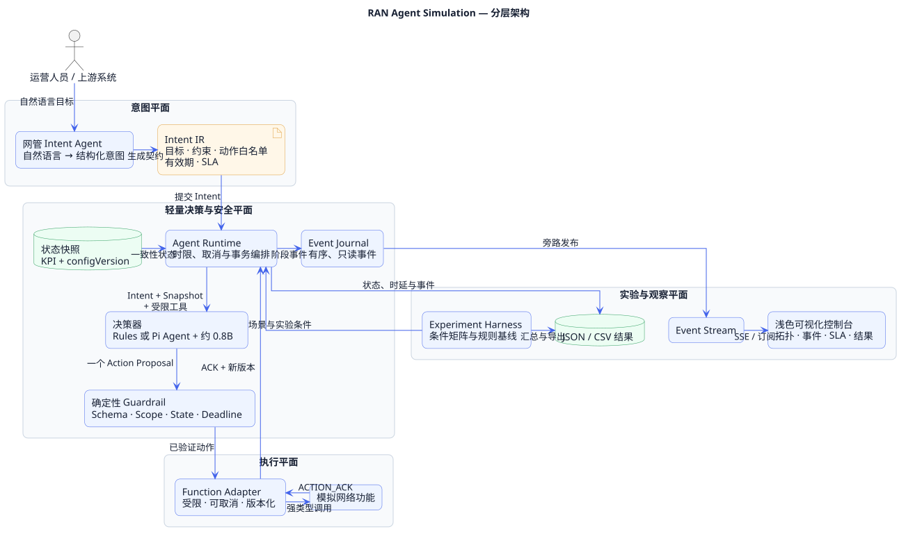
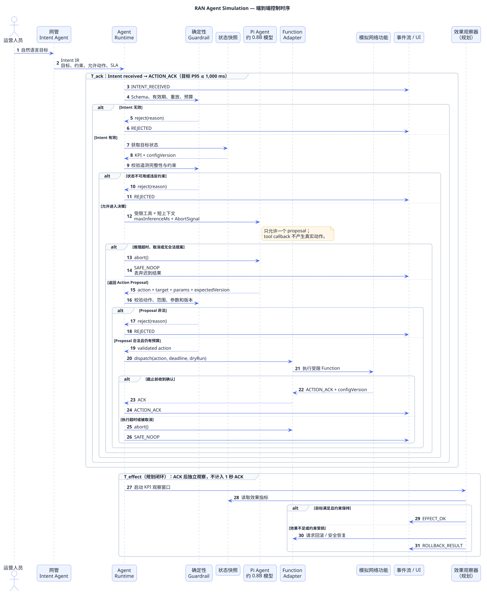
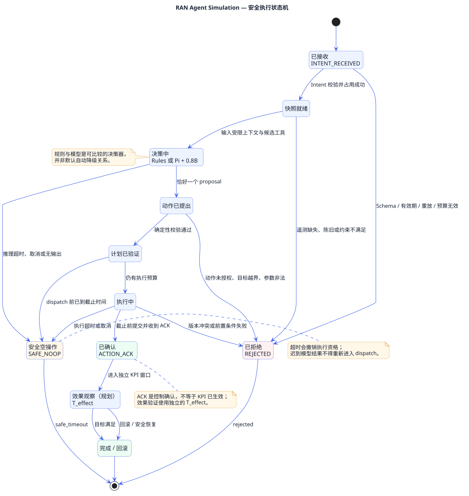

# RAN Agent Simulation

一个面向 RAN 智能控制的轻量化多 Agent 实验项目，研究“网管侧意图理解 + 基站侧小模型决策 + 确定性安全执行”能否形成可观测、可比较、可在 1 秒内确认的控制闭环。

项目的最小目标只回答两个问题：

1. 网管侧大模型能否把客户自然语言准确翻译成结构化 `Intent JSON`？
2. 基站侧约 0.8B 小模型能否读取该 Intent，通过 Pi Agent 生成正确的 `Tool Call`，并调用模拟 Function？

> 主界面只展示“客户意图 → Intent JSON → Tool Call → 模拟执行结果”。规则对照、故障注入、资源与容量信息保留在折叠的高级区域，不干扰核心测试。

## 核心设计原则

- **模型只提案，不执行**：Pi Agent 的工具回调只记录一个 Action Proposal，不能直接改变网络状态。
- **Intent 是能力契约**：目标、范围、约束、动作白名单、有效期和时限共同限定本次任务的执行权限。
- **时限是可撤销的执行资格**：推理或执行一旦超时，迟到结果失去 dispatch 资格。
- **确定性逻辑拥有最终执行权**：Schema、目标范围、参数、状态版本和剩余预算全部通过后才调用 Function。
- **控制确认与效果验证分开计时**：T_ack 截止于 ACTION_ACK；KPI 生效、观察和回滚属于独立的 T_effect。
- **观察链路不干扰控制事务**：事件订阅、SSE 或 UI 异常不能改变动作结果。

## 分层架构

[查看 PlantUML 源码](docs/diagrams/architecture.puml)

| 层次 | 主要职责 | 当前状态 |
|---|---|---|
| 网管 Intent Agent | 大模型将自然语言目标转换为结构化 Intent IR，并输出可审计解析阶段 | 合成解析器与独立远端大模型 API 路径已实现；真实效果待测 |
| Agent Runtime | 管理任务生命周期、总时限、取消、事件和结果 | 已实现 |
| Rules / Pi Agent | 在相同输入和工具约束下生成 Action Proposal | 规则、Pi faux、远端 API 和本机 Ollama 路径已实现 |
| Deterministic Guardrail | 校验 Intent、状态、动作、参数、范围、版本与预算 | 已实现 |
| Function Adapter | 将已验证动作映射为受限网络 Function | 模拟器已实现，真实适配器待接入 |
| Experiment & Observability | 运行条件矩阵，记录阶段时延并显示事件过程 | 已实现 |

核心接口被拆成三个版本化契约：

- **Intent**：上游希望达到什么目标，允许做什么，以及必须满足哪些限制。
- **Action**：决策器提出的单个动作、目标、参数和预期配置版本。
- **Event**：从接收、校验、推理、dispatch 到 ACK/拒绝的有序审计记录。

这种拆分使模型、执行后端和观察界面可以分别替换，而不把核心运行时绑定到某一种无线接入实现。

## 端到端交互逻辑

[查看 PlantUML 源码](docs/diagrams/control-sequence.puml)

自然语言解析属于网管侧阶段，不计入基站 Agent 的 1 秒控制预算；控制计时从已生成并验证的 Intent IR 提交给 Agent Runtime 开始。解析耗时和控制耗时在界面中分别展示。

主控制时延定义为：

**T_ack = Intent 接收 → 校验 → 状态快照 → 一次模型决策 → Guardrail → Function dispatch → ACTION_ACK**

1 秒目标只针对 T_ack。ACK 表示动作已被接受或应用，不代表 KPI 已经达到目标。

**T_effect = ACTION_ACK → KPI 观察窗口 → 目标满足 / 回滚**

T_effect 单独报告，避免用“快速 ACK”掩盖真实网络效果尚未发生的问题。

## 安全执行与失败语义

[查看 PlantUML 源码](docs/diagrams/safety-state.puml)

运行时只有三类控制终态：

- **succeeded**：在截止时间前收到 ACTION_ACK。
- **safe_timeout**：模型或执行超时，进入 SAFE_NOOP，迟到结果被丢弃。
- **rejected**：Intent、状态或 Action 不满足确定性约束，dispatch 不会发生。

当前安全核会在模型前检查有效期、未来时间、重复 Intent 和遥测约束，并在执行前检查动作白名单、目标范围、参数范围、配置版本和剩余预算。

## 可探索的创新点

以下是本项目希望验证的工程创新方向，不等同于已经证明的行业首创。

| 探索点 | 关键机制 | 能实现的新能力 | 状态 |
|---|---|---|---|
| 概率决策与确定性执行分离 | 模型只输出 proposal，独立安全核负责 dispatch | 使用小模型扩展任务覆盖，同时限制错误动作的影响面 | 已实现并有测试 |
| Deadline-aware Agent | 推理预算、总控制时限、AbortSignal 和 dispatch 前复查 | 把 1 秒从事后统计变成执行资格的一部分 | 已实现并有测试 |
| Intent 作为最小能力令牌 | 范围、动作白名单、约束、有效期和最大目标数量 | 每个任务只获得完成该任务所需的最小权限 | 核心校验已实现；签名待实现 |
| 观察层故障隔离 | 事件深拷贝、只读日志、监听器异常隔离 | 实时可视化和审计不会成为控制链路故障源 | 已实现并有测试 |
| AI 价值的规则门槛 | Rules、Pi faux、Pi + 0.8B 使用相同场景与指标 | 只有模型显著提高 Safe Task Completion 时才值得引入 | 实验框架已实现；本机基线已跑通，数据集评测待扩展 |
| ACK 与网络效果双时间轴 | T_ack 与 T_effect 分离，KPI 观察和回滚独立建模 | 同时评价控制实时性与业务效果，避免指标混淆 | 架构已定义；真实闭环待验证 |
| 可替换的执行适配层 | Intent/Action/Event 契约不依赖具体后端 | 同一安全运行时可连接模拟器、数字孪生或其他执行环境 | 模拟器已实现 |
| 测量与估算分离 | Agent 进程、本机模型/GPU、API 可见指标与芯片容量公式分别标注 | 避免把 faux、系统总量或推导值误写成芯片计数器 | 已实现并有测试 |

## 0.8B 与算力实验

实验不预设“小模型一定更好”。规则基线、框架开销和真实模型必须分开报告。

| 维度 | 首轮条件 | 重点观察 |
|---|---|---|
| 决策器 | Rules、Pi faux、Pi + 固定版本 0.8B | 正确性、增量覆盖率、框架开销 |
| 精度与状态 | INT4 / INT8；warm / cold；batch=1 | TTFT、完整工具调用时延、恢复时间 |
| SLA | 250 / 500 / 1,000 / 3,000 ms | P50 / P95 / P99 T_ack 与超时率 |
| 请求规模 | 256 / 512 输入 token；16 / 32 输出 token | 上下文和输出长度的时延拐点 |
| 工具规模 | 5 / 8 / 20 个候选工具 | 工具选择准确率和 schema valid rate |
| 算力 | 目标 CPU / 边缘 GPU、线程数、offload 和功耗模式 | RSS / VRAM、平均/峰值功耗、每个安全成功任务的能耗 |
| 故障条件 | 过期、冲突、陈旧遥测、越权、多工具、版本冲突、ACK 丢失、模型超时 | 正确拒绝、SAFE_NOOP、False Actuation、回滚 |

`Pi faux` 不包含任何 0.8B 模型权重或真实推理：它只运行真实 Pi Agent 协议与工具循环，并用预设响应/可控延迟验证框架开销和失败语义。真实 0.8B 结果必须使用 `Pi + 0.8B` 条件单独测量。

首个本机参考模型为 Ollama 的 `qwen3:0.6b`。当前运行时报告 `751.63M` 参数、`Q4_K_M` 量化和约 `572 MiB` 模型驻留，属于本项目“约 0.8B”目标量级。普通托管 API 仍可用于正确性测试，但不能提供服务端 TOPS、RAM/VRAM、内存带宽或功耗。

当前机器上的首轮真实基线如下；它只证明链路可行，不代表目标芯片结论：

| 项目 | 首轮观测 |
|---|---:|
| 本机环境 | Apple M1 Pro，14 核集成 GPU，16 GB 统一内存 |
| 模型 | qwen3:0.6b，751.63M，Q4_K_M |
| 模型驻留 | 约 572 MiB，Ollama `/api/ps` 实测 |
| 带遥测的 warm 模型阶段 | 约 434 ms，34 输出 token，约 78.3 token/s |
| 带遥测的 warm T_ack | 约 520 ms，正确 Tool Call 与 ACTION_ACK |
| 模糊参数语义 A/B | 30 次 Tool 名称 100% 正确，但参数 0%；全部由 no-op Guardrail 拒绝，未执行 |
| 精确字段映射 A/B | 30/30 Tool、参数和任务均正确；P50 391 ms，P95 431 ms，最大 541 ms |
| 工作负载等效值 | 约 0.12 TOPS、47.0 GB/s；由实测吞吐推导，不是芯片峰值计数器 |
| cold 现象 | 首次请求超过 800 ms 推理预算并安全进入 SAFE_NOOP |

按 800 ms 模型预算、32 输出 token、预留 25% 给 prefill/运行时、INT4 和 batch=1 的筛选公式，当前建议从 **≥0.7 INT4 TOPS、≥50 GB/s 内存带宽、≥2 GiB 可用内存、≥2 GiB 模型存储** 的候选点开始验证。这里的 TOPS/带宽是带效率与余量的首轮规划值；30 次 warm 结果也只是单场景初测，最终平衡点必须来自同一量化文件、推理后端和候选芯片上的多场景正确率、P95/P99、功耗与成本对比。

这次 A/B 也说明约 0.8B 模型不能依赖模糊提示词：`objective.metric + objective.direction → 参数枚举` 必须写成短而精确的工具契约，同时由确定性 Guardrail 拒绝“返回当前值”、目标方向不一致和越界参数。时延达标与任务正确率必须分别统计。

首轮探索性 Go/No-Go 门槛：

- False Actuation Rate = 0。
- Schema valid rate ≥ 99.5%。
- 正常单步任务的工具与参数正确率 ≥ 98%。
- warm、batch=1、1,000 ms profile 的 P95 T_ack ≤ 1,000 ms。
- 超时、遥测失效或模型异常只能进入 SAFE_NOOP、拒绝或显式规则路径。
- 0.8B 只有在 Safe Task Completion 明显优于规则基线时才进入下一阶段。

这些门槛用于实验筛选，不是生产网络验收值。完整假设、采样方法和结果解释见 [实验设计](docs/EXPERIMENT_PLAN.md)。

## 当前边界

已经实现：

- 单轮、单工具提案和确定性二次校验。
- 推理与执行 deadline、取消和迟到结果丢弃。
- Intent 时效、重放、状态约束、动作范围和参数校验。
- 规则基线、Pi faux、外部本地模型连接路径和 JSON/CSV 实验结果。
- 网管大模型与基站小模型各自独立的 OpenAI-compatible API 配置、模式选择和来源标记；两个 key 只保留在当前本地服务进程内存，也可改用服务端环境变量。
- 推理期间 Agent CPU/RSS/Heap、token 使用和测量来源标记。
- 约 0.8B INT4 的 TOPS、RAM、双槽存储与内存带宽可审计容量估算。
- Pi Agent 请求摘要、工具 Schema、实际 tool call 参数、Proposal、Guardrail、Function dispatch 与 ACK 的完整调用轨迹；faux 与真实 API 明确区分。
- 网管大模型的强制结构化 Tool Call、token/耗时，以及合成解析器的 8 阶段基线；两者都输出完整 Intent IR 并通过相同确定性 Schema 校验。
- 有序 Runtime/Pi 事件、SSE 实时控制台与观察器故障隔离。

尚未完成：

- 网管侧真实大模型的领域测试集、准确率/鲁棒性评测和模型选型结论。
- Intent 签名验证以及跨进程、跨重启的持久化防重放。
- 真实 0.8B INT4/INT8 在目标芯片上的 P95/P99、准确率、功耗与单位成本测量；当前仅完成 M1 Pro 本机基线。
- 真实执行适配器、KPI 效果闭环和回滚验证。

因此，本项目目前证明的是“安全运行时和实验方法可以工作”，不是“0.8B 已经在真实网络中达到 1 秒”。

## 快速开始

本机小模型已经可以通过 Ollama 运行。新环境可按以下方式安装并启动：

    brew install ollama
    brew services start ollama
    ollama pull qwen3:0.6b

运行安全路径测试、真实本机 Pi Agent 示例和实时任务控制台：

    cd agent-runtime
    npm ci
    npm test
    npm run demo:local
    npm run live

打开 http://127.0.0.1:4175。基站侧默认连接 `http://127.0.0.1:11434/v1` 的 `qwen3:0.6b`，无需 API Key；选择 `Pi Agent · 本机小模型` 即可查看真实 Tool Call、Function ACTION_ACK、模型驻留、GPU/统一内存采样、token/s 和工作负载等效 TOPS/带宽。网管侧可先使用合成解析器，也可单独配置大模型 API 来测试自然语言到 Intent JSON。

不在本机运行模型时，可以在界面配置两套 API，也可以使用独立环境变量启动：

    RAN_INTENT_MODEL_BASE_URL=https://management-model.example/v1 \
    RAN_INTENT_MODEL_ID=Qwen/Qwen3-8B \
    RAN_INTENT_MODEL_API_KEY=management_key \
    RAN_STATION_MODEL_BASE_URL=https://station-model.example/v1 \
    RAN_STATION_MODEL_ID=Qwen/Qwen3-0.6B \
    RAN_STATION_MODEL_API_KEY=station_key \
    npm run live

启动实验仪表盘：

    cd ran-agent-dashboard
    npm ci
    npm run dev

## 文档与目录

- [技术规范（SPEC）](SPEC.md)：系统契约、时限、安全语义和验收条件。
- [Simulation Test](Simulation%20Test.md)：本地模型调用、资源观测与超时保护快照。
- [Agent Runtime](agent-runtime/README.md)：运行方式、本地模型接口和生产差距。
- [实验设计](docs/EXPERIMENT_PLAN.md)：研究假设、因子矩阵、指标与门槛。
- [开源项目参考](docs/REFERENCE_PROJECTS.md)：可借鉴项目、可复用部分与差距。
- [PlantUML 图表](docs/diagrams/README.md)：架构图源码与重新生成方法。

重新生成 README 中的 SVG：

    plantuml -checkonly docs/diagrams/*.puml
    plantuml -tsvg docs/diagrams/*.puml

## License

本项目采用 [MIT License](LICENSE)。
