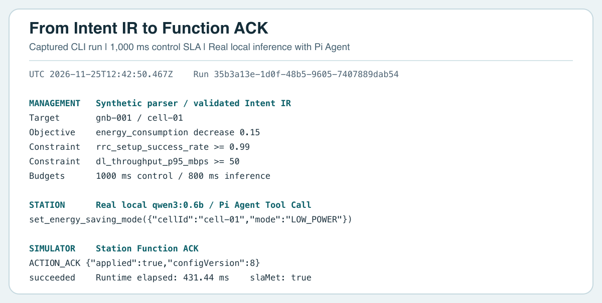
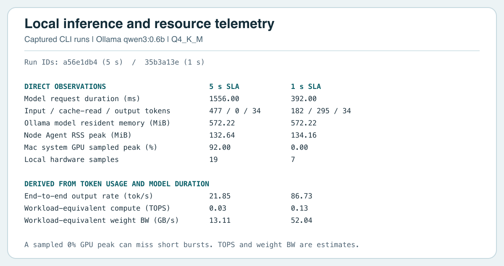
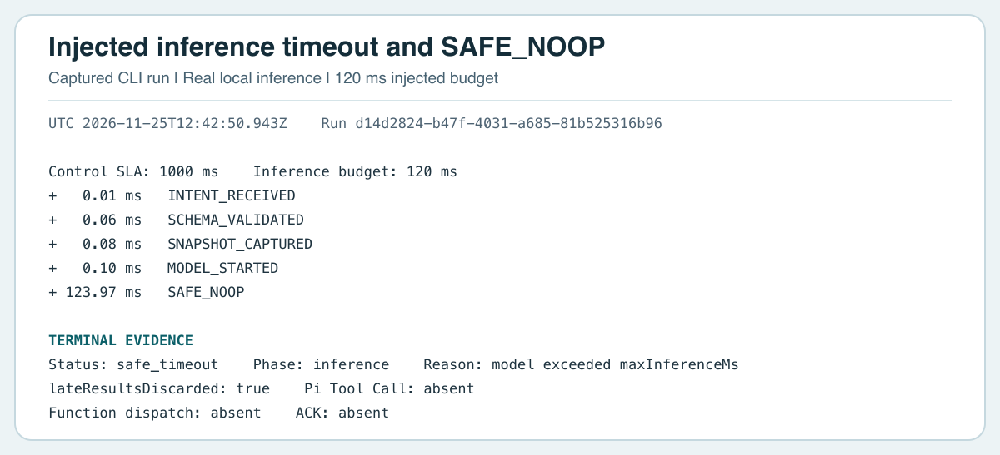

# Simulation Test

2026-11-25 · 运行基线 `e2440c7` · Mac 本地 Ollama `qwen3:0.6b`（`Q4_K_M`）

网管侧用合成解析器生成 Intent IR。基站侧由真实本地模型通过 Pi Agent 生成 Tool Call，Station Function 在模拟器中执行。下方 PNG 由本次命令行运行捕获的真实事件与遥测排版生成。浏览器截图连接超时，未取得网页原图。

## 测试结果

三次运行使用同一个节能场景，将 `gnb-001/cell-01` 切换为低功耗模式，目标节能 15%，要求下行 P95 吞吐至少 50 Mbps、RRC 成功率至少 99%。从基站 Runtime 收到结构化意图开始计时。

| 场景 | 控制 / 推理预算 | 基站耗时 | 终态 |
| --- | ---: | ---: | --- |
| 5 秒标准档，先运行 | 5,000 / 4,800 ms | 1,658.96 ms | `ACTION_ACK`，已应用 |
| 1 秒标准档，紧接上次运行 | 1,000 / 800 ms | 431.44 ms | `ACTION_ACK`，已应用 |
| 推理超时注入 | 1,000 / 120 ms | 123.95 ms | `SAFE_NOOP`，未分派 Function |

每档各一次。1 秒档读取了 295 个缓存 token，431.44 ms 是该次带缓存样本的结果。稳定达标需要多次测量和 P95/P99。`ACTION_ACK` 确认模拟配置已应用，节能与吞吐的实际变化需另行验证。

### Intent IR、Tool Call 与 Function ACK

1 秒档生成 `set_energy_saving_mode`，参数为 `cellId: cell-01`、`mode: LOW_POWER`。模拟 Function 回传 `applied: true`，配置版本从 7 升到 8。

### 本地推理与资源

两次成功运行的 Ollama 模型驻留内存均为 572.22 MiB。模型请求耗时分别为 1,556 ms 和 392 ms，各生成 34 个输出 token。后一轮系统 GPU 采样峰值为 0%，短时负载可能落在采样间隔内。图中的等效 TOPS 和权重带宽由吞吐推导。

### 超时保护

故障场景将推理预算降至 120 ms。事件流从 `MODEL_STARTED` 进入 `SAFE_NOOP`。无 Tool Call、无 Function 分派、无 ACK。

## 复测

启动 `agent-runtime/` 下的 `npm run live`，在控制台使用合成解析器和本机小模型，展示速度设为实时。先在正常场景分别用 5 秒和 1 秒的确认时限运行同一条意图，再以 1 秒时限选择“模型超时”场景。验收条件见 [SPEC.md](SPEC.md)，批量测量口径见 [实验计划](docs/EXPERIMENT_PLAN.md)。
